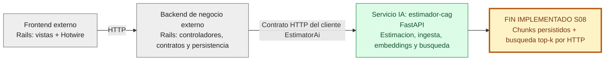
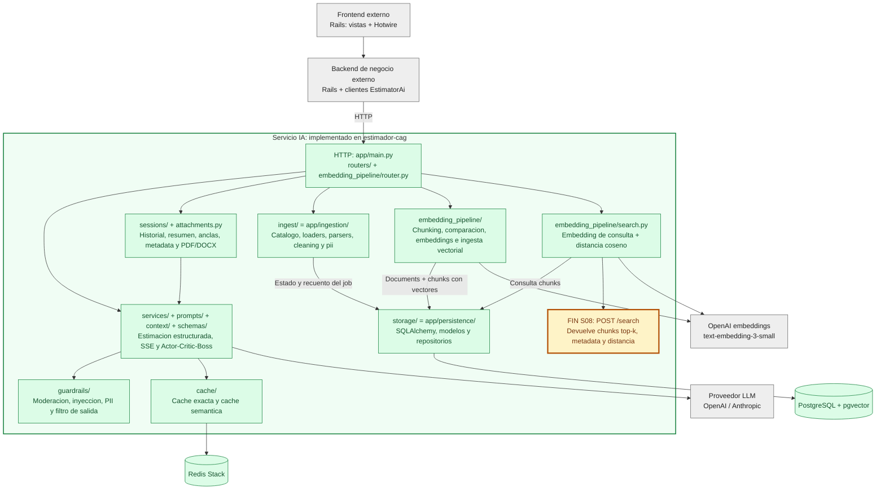
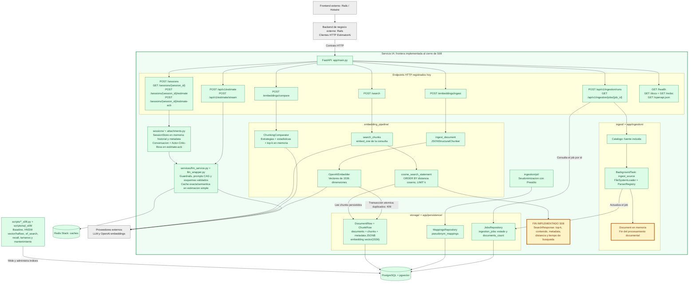

# Arquitectura personal: cierre de Sesion 08

Tres vistas de menor a mayor complejidad. Se omite Streamlit.

**Alcance:** verde = implementado en `estimador-cag`; gris = cliente Rails existente en el proyecto vecino `ai-engineering/estimator-web`, mostrado solo como contexto de las dos primeras capas; amarillo = punto donde termina el flujo implementado. Las flechas entre Rails y la API representan el contrato HTTP, no una comprobacion de despliegue conjunto.

Los nombres solicitados son logicos: **`ingest/` corresponde a `app/ingestion/`** y **`storage/` corresponde a `app/persistence/`**. `embedding_pipeline/` existe como `app/embedding_pipeline/`. No se inventan directorios ni componentes pendientes.

## 1. Vista general: tres capas

## 2. Vista modular del servicio IA

La ingesta documental registra jobs y produce documentos en memoria; no llama automaticamente a la ingesta vectorial. La limpieza y la seudonimizacion existen como utilidades, pero no se representan como pasos automaticos del orquestador. La busqueda de chunks tampoco se conecta al prompt de estimacion: son caminos independientes en el codigo actual.

## 3. Endpoints y flujos internos

**Limite operativo S08:** las migraciones dejan el baseline sin indice vectorial. Hay scripts implementados para crear y comparar HNSW `vector` y `halfvec`; no se afirma que esos indices esten creados en una base de datos concreta. `/search` ejecuta la consulta por distancia coseno sobre los vectores persistidos.

**Superficie auxiliar:** `app/main.py` tambien monta `/static` si existe `app/static/`; sirve recursos estaticos, no un endpoint de negocio. Swagger, ReDoc y OpenAPI documentan la API existente.

### Fuentes verificables

- [Registro de routers y health](app/main.py).
- [Estimaciones](app/routers/estimations.py) y [sesiones](app/routers/sessions.py).
- [Ingesta HTTP](app/routers/ingestion.py) y [orquestador documental](app/ingestion/orchestrator.py).
- [Endpoints de embeddings](app/embedding_pipeline/router.py) e [ingesta vectorial](app/embedding_pipeline/ingestion.py).
- [Endpoint de busqueda](app/routers/search.py) y [consulta por coseno](app/embedding_pipeline/search.py).
- [Modelos de almacenamiento](app/persistence/models.py) y [alcance operativo S08](README.md).