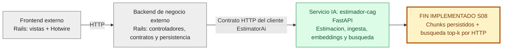
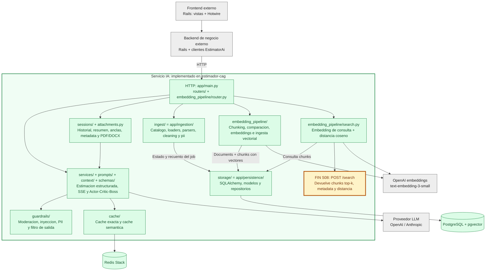
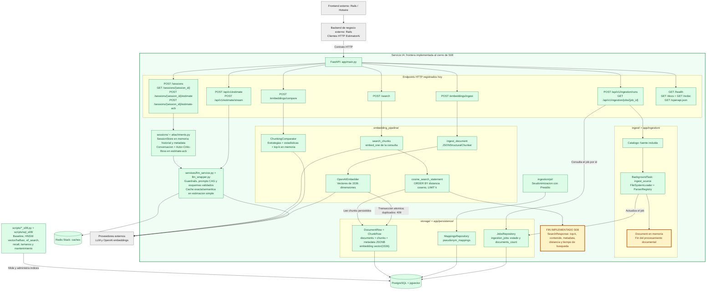
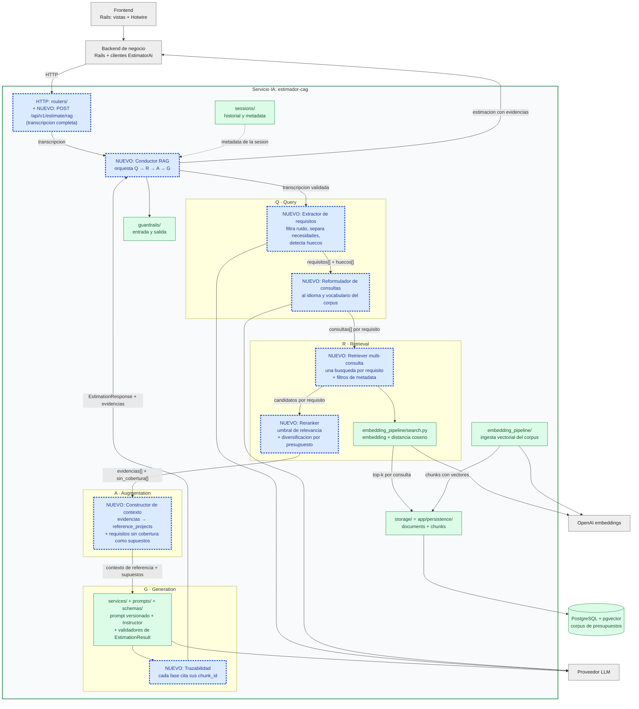

# Arquitectura personal: cierre de Sesion 08

Tres vistas de menor a mayor complejidad. Se omite Streamlit.

**Alcance:** verde = implementado en `estimador-cag`; gris = cliente Rails , mostrado solo como contexto de las dos primeras capas; amarillo = punto donde termina el flujo implementado. Las flechas entre Rails y la API representan el contrato HTTP, no una comprobacion de despliegue conjunto.

Los nombres solicitados son logicos: **`ingest/` corresponde a `app/ingestion/`** y **`storage/` corresponde a `app/persistence/`**. `embedding_pipeline/` existe como `app/embedding_pipeline/`. 

## 1. Diagrama de la arquitectura actual

### 1.1 Vista general: tres capas



### 1.2 Vista modular del servicio IA



La ingesta documental registra jobs y produce documentos en memoria; no llama automaticamente a la ingesta vectorial. La limpieza y la seudonimizacion existen como utilidades, pero no se representan como pasos automaticos del orquestador. La busqueda de chunks tampoco se conecta al prompt de estimacion: son caminos independientes en el codigo actual.

### 1.3 Endpoints y flujos internos



**Limite operativo S08:** las migraciones dejan el baseline sin indice vectorial. Hay scripts implementados para crear y comparar HNSW `vector` y `halfvec`; no se afirma que esos indices esten creados en una base de datos concreta. `/search` ejecuta la consulta por distancia coseno sobre los vectores persistidos.

**Superficie auxiliar:** `app/main.py` tambien monta `/static` si existe `app/static/`; sirve recursos estaticos, no un endpoint de negocio. Swagger, ReDoc y OpenAPI documentan la API existente.

### Fuentes verificables

- [Registro de routers y health](app/main.py).
- [Estimaciones](app/routers/estimations.py) y [sesiones](app/routers/sessions.py).
- [Ingesta HTTP](app/routers/ingestion.py) y [orquestador documental](app/ingestion/orchestrator.py).
- [Endpoints de embeddings](app/embedding_pipeline/router.py) e [ingesta vectorial](app/embedding_pipeline/ingestion.py).
- [Endpoint de busqueda](app/routers/search.py) y [consulta por coseno](app/embedding_pipeline/search.py).
- [Modelos de almacenamiento](app/persistence/models.py) y [alcance operativo S08](README.md).

## 2. Trace anotado de una transcripción

Trace manual de [02_ambiguous.txt](examples/transcripts/02_ambiguous.txt) a traves del sistema tal como esta hoy, ejecutado el 2026-11-01 con el script cliente [examples/trace_s09.py](examples/trace_s09.py) . El script no anade comportamiento al servicio: embebe la transcripcion y llama a `/search`.

**Estado del sistema durante el trace:**

- Stack: `estimator` + `postgres` (pgvector) + `redis`, levantados con `docker compose up -d --build estimator`.
- Corpus: los 15 presupuestos de `data/budgets_sample.json`, ingeridos con `scripts/query_examples.py` via `POST /embeddings/ingest` (`document_type = historical_budget`), en total 52 chunks `budget_component`, todos con embedding.
- Indices de `chunks`: `chunks_pkey`, `ix_chunks_document_id`, `ix_chunks_chunk_type` y `ix_chunks_metadata_gin`. **No hay indice HNSW**, por lo que la busqueda es un sequential scan exacto (baseline de S08).

```powershell
docker compose up -d --build estimator
docker compose run --rm -e ESTIMATOR_BASE_URL=http://estimator:8000 estimator python scripts/query_examples.py
docker compose run --rm `
  -v "${PWD}/examples:/app/examples:ro" `
  -e ESTIMATOR_BASE_URL=http://estimator:8000 `
  estimator python examples/trace_s09.py examples/transcripts/02_ambiguous.txt
```

### Paso 1 — Embeber la transcripción completa

No hay endpoint HTTP que devuelva un embedding crudo (el embedding ocurre dentro de `/search`), asi que el script llama a OpenAI directamente con el mismo modelo que usa la ingesta.

```text
STEP 1 — embedding of the full transcript
transcript      : examples/transcripts/02_ambiguous.txt
model           : text-embedding-3-small
dimensionality  : 1536
L2 norm         : 0.999691
first component : 0.006233
last component  : 0.019012
```

**Comentario:** el vector tiene la dimension de la columna `vector(1536)` y norma ~1 (OpenAI devuelve vectores normalizados), asi que distancia coseno y producto interno ordenan igual. Toda la reunion, unos 3 KB de texto con saludos, dudas e ideas sueltas, queda comprimida en **un unico vector**: las cinco necesidades distintas se promedian en un solo punto.

### Paso 2 — Búsqueda semántica (top-5)

```text
POST /search  {"query": "<transcripcion completa>", "k": 5}

search_time_ms  : 324
results         : 5

  rank  chunk_id  distance  sector     budget_id     content
     1        16    0.6083  ecommerce  BUD-2024-005  [Project: Headless e-commerce storefront ...] Component: Product catalog API
     2        17    0.6138  ecommerce  BUD-2024-005  [Project: Headless e-commerce storefront ...] Component: Cart and checkout service
     3        18    0.6372  ecommerce  BUD-2024-005  [Project: Headless e-commerce storefront ...] Component: Personalized recommendations
     4        19    0.6388  ecommerce  BUD-2024-005  [Project: Headless e-commerce storefront ...] Component: Storefront PWA
     5        27    0.6444  ecommerce  BUD-2024-008  [Project: Fashion returns management and resale portal] Component: Returns portal
```

Respuesta cruda (`query` omitida, es la transcripcion completa):

```json
{
  "k": 5,
  "search_time_ms": 324,
  "results": [
    {
      "chunk_id": 16, "document_id": 5, "chunk_type": "budget_component",
      "content": "[Project: Headless e-commerce storefront with personalized recommendations]\n[Client sector: ecommerce | Year: 2024 | Main tech: node]\n\nComponent: Product catalog API\nDescription: GraphQL catalog API with faceted search, inventory availability and multi-currency pricing backed by Elasticsearch.\nTech stack: node, graphql, elasticsearch\nComplexity: medium\nEstimated hours: 150",
      "distance": 0.6082954696301268,
      "metadata": {"year": 2024, "budget_id": "BUD-2024-005", "complexity": "medium", "component_id": "CATALOG-001", "client_sector": "ecommerce", "estimated_hours": 150, "main_technology": "node"}
    },
    {
      "chunk_id": 17, "document_id": 5, "chunk_type": "budget_component",
      "content": "[Project: Headless e-commerce storefront with personalized recommendations]\n[Client sector: ecommerce | Year: 2024 | Main tech: node]\n\nComponent: Cart and checkout service\nDescription: Stateless cart service with promotion engine, tax calculation and a checkout orchestration that integrates the payment provider.\nTech stack: node, redis, postgresql\nComplexity: high\nEstimated hours: 140",
      "distance": 0.6138128095161743,
      "metadata": {"year": 2024, "budget_id": "BUD-2024-005", "complexity": "high", "component_id": "CART-002", "client_sector": "ecommerce", "estimated_hours": 140, "main_technology": "node"}
    },
    {
      "chunk_id": 18, "document_id": 5, "chunk_type": "budget_component",
      "content": "[Project: Headless e-commerce storefront with personalized recommendations]\n[Client sector: ecommerce | Year: 2024 | Main tech: node]\n\nComponent: Personalized recommendations\nDescription: Collaborative-filtering recommendations served from a feature store and exposed as a low-latency API for product and cart pages.\nTech stack: node, redis\nComplexity: medium\nEstimated hours: 110",
      "distance": 0.6372392309978392,
      "metadata": {"year": 2024, "budget_id": "BUD-2024-005", "complexity": "medium", "component_id": "RECO-003", "client_sector": "ecommerce", "estimated_hours": 110, "main_technology": "node"}
    },
    {
      "chunk_id": 19, "document_id": 5, "chunk_type": "budget_component",
      "content": "[Project: Headless e-commerce storefront with personalized recommendations]\n[Client sector: ecommerce | Year: 2024 | Main tech: node]\n\nComponent: Storefront PWA\nDescription: Progressive web app storefront consuming the headless APIs with server-side rendering for SEO.\nTech stack: next_js, react\nComplexity: low\nEstimated hours: 60",
      "distance": 0.6387926562842304,
      "metadata": {"year": 2024, "budget_id": "BUD-2024-005", "complexity": "low", "component_id": "STORE-004", "client_sector": "ecommerce", "estimated_hours": 60, "main_technology": "node"}
    },
    {
      "chunk_id": 27, "document_id": 8, "chunk_type": "budget_component",
      "content": "[Project: Fashion returns management and resale portal]\n[Client sector: ecommerce | Year: 2023 | Main tech: dotnet]\n\nComponent: Returns portal\nDescription: Self-service returns portal with label generation, reason capture and automatic restock or resale routing.\nTech stack: dotnet, sqlserver\nComplexity: medium\nEstimated hours: 140",
      "distance": 0.6443924190186967,
      "metadata": {"year": 2023, "budget_id": "BUD-2024-008", "complexity": "medium", "component_id": "RET-001", "client_sector": "ecommerce", "estimated_hours": 140, "main_technology": "dotnet"}
    }
  ]
}
```

**Comentario:** el sector acierta (los 5 chunks son `ecommerce`), pero las distancias son altas y planas: de 0.608 a 0.644, una diferencia de 0.036 entre el primero y el quinto. Ningun resultado destaca: el ranking separa poco y no hay umbral que diga "esto no es suficientemente parecido".

### Paso 3 — Lectura de los chunks devueltos

Necesidades de la transcripcion: (a) tienda online, (b) pago con tarjeta y recuperacion de carritos abandonados, (c) fidelizacion por puntos o club, (d) panel diario de pedidos, ventas y stock, (e) email de confirmacion del pedido. Cliente pequeno, sin equipo tecnico, mercado España con Francia como posibilidad.

| Rank | Chunk (presupuesto historico) | Sector | ¿Relevante? |
|---|---|---|---|
| 1 | `CATALOG-001` Product catalog API, BUD-2024-005 (ShopSphere, ES) | ecommerce | **Parcial.** Cubre (a), pero es una API GraphQL con Elasticsearch y multidivisa: sobredimensionada para una tienda de conservas y vinos. Sus 150 h no sirven de referencia directa. |
| 2 | `CART-002` Cart and checkout service, BUD-2024-005 | ecommerce | **Si, el mas util.** Es el unico que toca (b): checkout con integracion del proveedor de pago. Aun asi, no aborda carritos abandonados y su complejidad es alta. |
| 3 | `RECO-003` Personalized recommendations, BUD-2024-005 | ecommerce | **No.** Rubén no pide recomendaciones. Probablemente entra por la vecindad semantica "cliente que repite / fidelizar" ↔ "personalizacion". Es un falso positivo. |
| 4 | `STORE-004` Storefront PWA, BUD-2024-005 | ecommerce | **Parcial.** Es el frontal de (a), pero con PWA y SSR en Next.js, mas de lo que pide un primer proyecto. Las 60 h son la referencia mas razonable del top-5. |
| 5 | `RET-001` Returns portal, BUD-2024-008 (StyleLoop, IT) | ecommerce | **No.** La transcripcion no menciona devoluciones. Ademas, la metadata es incoherente: `budget_id` 2024 con `year` 2023. |

**Lectura honesta:** de 5 chunks, 1 es util, 2 lo son parcialmente y 2 son ruido. Cuatro de los cinco salen del **mismo presupuesto** (BUD-2024-005), asi que el top-5 apenas aporta diversidad. Tres necesidades quedan **sin ninguna evidencia recuperada**:

- **(c) Fidelizacion:** ningun chunk del corpus habla de loyalty, puntos ni club.
- **(d) Panel:** si existen dashboards en el corpus (`Merchant dashboard` de BUD-2024-003, `Care team dashboard` de BUD-2024-010), pero quedan fuera del top-5 porque pertenecen a otros sectores.
- **(e) Email transaccional:** `Push and email notifications` (BUD-2024-001, finance) existe y tampoco aparece.

El fallo no es solo que falte informacion en el corpus: buscar la reunion entera como una sola query diluye cinco necesidades en un vector medio que gravita hacia "tienda online generica".

**Donde acaba el sistema:** `/search` devuelve los chunks y ahi termina el flujo implementado. Ningun componente traduce esta transcripcion en una estimacion usando estos chunks; ese paso hoy es manual.

## 3. Diagnóstico

Cinco fallos que hoy impiden convertir [02_ambiguous.txt](examples/transcripts/02_ambiguous.txt) en una estimación de calidad, ordenados de más a menos relevante. Además del trace, se apoyan en tres comprobaciones hechas el 2026-11-01 sobre el mismo stack y el mismo corpus (15 presupuestos, 52 chunks):

- **Consultas cortas por necesidad** a `POST /search` (`k=3`), en español y en inglés:

  | Consulta | Mejor distancia | Mejor chunk |
  |---|---|---|
  | `programa de puntos para fidelizar clientes que repiten` | 0.7575 | Cart and checkout service (BUD-2024-005) |
  | `customer loyalty points program` | 0.6735 | Cart and checkout service (BUD-2024-005) |
  | `panel diario con pedidos, ventas y stock` | 0.6365 | Inventory and reorder (BUD-2024-011, healthcare) |
  | `admin dashboard with daily orders, sales and stock levels` | **0.5826** | **Merchant dashboard** (BUD-2024-003, finance) |
  | `correo de confirmación cuando un cliente compra` | 0.7332 | Cart and checkout service (BUD-2024-005) |
  | `transactional email order confirmation` | 0.6946 | Split order management (BUD-2024-006) |

- **La transcripción completa enviada a `POST /api/v1/estimate`:** la API responde `422 string_too_long` (*"String should have at most 2000 characters"*). La transcripción tiene 2.898 caracteres.
- **Lectura del código:** [app/embedding_pipeline/search.py](app/embedding_pipeline/search.py), [app/embedding_pipeline/schemas.py](app/embedding_pipeline/schemas.py), [app/prompts/loader.py](app/prompts/loader.py), [app/services/llm_service.py](app/services/llm_service.py) y [data/budgets_sample.json](data/budgets_sample.json).

### Fallo 1 — La reunión entera se busca como un único vector

- **Problema observado:** al embeber los 2.898 caracteres de la transcripción contra chunks de un componente (~400 caracteres), las cinco distancias quedan en una franja de 0.036 (de 0.608 a 0.644). El panel de control y el email de confirmación, que Rubén pide de forma explícita, no aparecen en el top-5. En cambio, la consulta corta *"admin dashboard with daily orders, sales and stock levels"* devuelve `Merchant dashboard` en primer lugar con 0.583, mejor que cualquier resultado del trace.
- **Causa probable:** `/search` embebe `request.query` tal cual llega (`embedder.embed_one(request.query)`). Ninguna etapa separa la reunión en requisitos antes de buscar. Existe `extract_requirements` (modo `two_phase` en `llm_service.py`), pero solo la usa `generate_estimation`, a la que no llama ningún endpoint, y nunca alimenta a `/search`. Cinco necesidades distintas, más saludos y dudas, se promedian en un vector que gravita hacia "tienda online genérica".
- **Propuesta de solución:** una etapa de **extracción y descomposición de requisitos** previa a la recuperación, que convierta la transcripción en una lista de necesidades y lance una búsqueda por cada una.

### Fallo 2 — Brecha de idioma y registro entre la consulta y el corpus

- **Problema observado:** la misma necesidad formulada en español conversacional queda sistemáticamente más lejos que en inglés técnico: fidelización 0.758 frente a 0.674 (+0.084) y panel 0.637 frente a 0.583 (+0.054). En español, el panel ni siquiera recupera un dashboard en primer lugar (sale `Inventory and reorder`).
- **Causa probable:** el corpus está ingerido en inglés técnico (`Component: ... Tech stack: ...`), mientras que la transcripción es un español coloquial, con muletillas ("¿eh?", "te lo juro") y sin vocabulario técnico. Nada normaliza la consulta antes de embeberla.
- **Propuesta de solución:** una etapa de **reformulación de la consulta** que traduzca cada requisito al vocabulario y al idioma del corpus (por ejemplo, "algo de puntos o un club" → *loyalty points program*) antes de buscar.

### Fallo 3 — La búsqueda nunca dice "no hay nada parecido"

- **Problema observado:** para la fidelización, el corpus no tiene ningún componente de loyalty, puntos ni club. Aun así, `/search` devuelve siempre `k` resultados: *Cart and checkout* (0.674), *Personalized recommendations* (0.699) y *Returns portal* (0.712). En el trace, `Personalized recommendations` y `Returns portal` ocupan los puestos 3 y 5 sin tener relación con lo pedido.
- **Causa probable:** `SearchRequest` solo admite `query` y `k`, y la consulta es un `ORDER BY distancia LIMIT k`, sin umbral de similitud. Una distancia de 0.70 se presenta igual que una de 0.58, y quien consume el resultado no puede distinguir evidencia real de relleno.
- **Propuesta de solución:** un **umbral de relevancia** (o un reranker con puntuación calibrada) que descarte resultados débiles y marque de forma explícita los requisitos **sin cobertura** en el corpus, para que la estimación los trate como supuestos y no como datos históricos.

### Fallo 4 — El top-k se concentra en un solo presupuesto y no usa la metadata

- **Problema observado:** 4 de los 5 chunks del trace son del mismo presupuesto (BUD-2024-005). Mientras tanto, `Merchant dashboard` (BUD-2024-003) y `Push and email notifications` (BUD-2024-001), los componentes más útiles para el panel y el email, quedan fuera porque son de otros sectores.
- **Causa probable:** la recuperación es un top-k puro por coseno, sin diversificación (como límite por presupuesto o MMR) y sin filtros. `chunks.metadata` tiene índice GIN y guarda `client_sector`, `complexity` y `estimated_hours`, pero `/search` no permite filtrar ni ponderar por esos campos.
- **Propuesta de solución:** **diversificación del top-k** (máximo de chunks por presupuesto) y **filtros o reranking por metadata**, de modo que un componente de otro sector pueda entrar cuando cubre un requisito que el sector propio no cubre.

### Fallo 5 — Lo que se recupera nunca llega a la generación de la estimación

- **Problema observado:** aunque `/search` devolviera los chunks perfectos, ningún flujo de estimación los usa. La ruta conversacional (`/sessions/{id}/estimate`) renderiza el prompt con `reference_projects=None`. `/api/v1/estimate/stream` inyecta siempre los mismos ejemplos: `select_examples(n)` devuelve los *primeros* `n` de una lista fija de `context/examples.py`, sean cuales sean los presupuestos parecidos a la reunión. La ruta transaccional rechaza la transcripción con `422`.
- **Causa probable:** RAG (`embedding_pipeline/`) y generación (`services/` + `prompts/`) son dos caminos independientes. El contrato ya tiene el hueco (`EstimationRequest.reference_projects`, con `name`, `summary`, `total_hours` y `total_cost`), pero solo lo rellena quien llama, a mano. No hay ningún orquestador que conecte recuperación → contexto → prompt.
- **Propuesta de solución:** una **etapa de generación aumentada por recuperación** en el orquestador del servicio: convertir los chunks recuperados (y los requisitos sin cobertura) en el contexto de referencia del prompt de estimación, en ambos flujos.

### Otros

- **El flujo transaccional rechaza transcripciones reales:** `EstimationRequest.description` admite como máximo 2.000 caracteres, y una reunión de cinco minutos ya los supera (`422 string_too_long`). Solo la ruta de sesiones (hasta 50.000) acepta la transcripción.
- **Cobertura y escala del corpus:** los 15 presupuestos van de 300 a 620 h y son de clientes medianos en finanzas, salud, industria y e-commerce. No hay ningún comercio pequeño, ni ningún componente de fidelización. Incluso con una recuperación perfecta, las referencias históricas tienden a sobredimensionar un proyecto como el de Casa Castaño.
- **No se detecta la ambigüedad:** la transcripción no fija volumen de pedidos, mercados (España, quizá Francia), catálogo ni integraciones. Nada en el flujo identifica esos huecos para convertirlos en preguntas al cliente o en supuestos explícitos de la estimación.
- **Chunks sin contexto de presupuesto:** cada chunk lleva las horas de su componente, pero no el total del presupuesto ni el tamaño del equipo. Por eso es difícil escalar una referencia al proyecto completo.
- **Metadata incoherente:** el presupuesto `BUD-2024-008` declara `year: 2023`, aunque su identificador es de 2024. Si en el futuro se filtra o se pondera por antigüedad, este dato lo distorsiona.
- **La transcripción se utiliza tal cual sin filtrar:** bajo mi punto de vista se chunkean y embeben partes irrelevantes de la transcripción como los saludos que se debería de filtrar quiza´s con una primera llamada al LLM.

## 4. Propuesta de evolución arquitectónica

Misma arquitectura de tres capas que en la sección 1, con el servicio IA completado por un pipeline **Query → Retrieval → Augmentation → Generation** sobre el corpus de PostgreSQL. **Azul con borde discontinuo = NUEVO**; verde = ya existe (sección 1.2). Desaparece la caja amarilla "FIN S08": el flujo ya no se detiene en `/search`, termina en una estimación con evidencias.



`API` aparece en azul porque el router existe, pero el endpoint que recibe la transcripción completa es nuevo (hoy `/api/v1/estimate` la rechaza con `422`).

**Responsabilidades y flujo de datos.** El *Conductor RAG* recibe la transcripción y orquesta las cuatro etapas. El *Extractor de requisitos* elimina el ruido conversacional y devuelve `requisitos[]` y `huecos[]` (volumen, mercados...). El *Reformulador* traduce cada requisito a una consulta en el idioma y vocabulario del corpus. El *Retriever multi-consulta* lanza una búsqueda por consulta sobre el `search.py` existente, con filtros de metadata. El *Reranker* aplica umbral y diversificación y separa `evidencias[]` de `sin_cobertura[]`. El *Constructor de contexto* convierte las evidencias en `reference_projects` y lo no cubierto en supuestos explícitos. La generación existente produce el `EstimationResult`, y la *Trazabilidad* une cada fase a los `chunk_id` que la justifican.
**Pieza más crítica:** el **Extractor de requisitos** (con su reformulación). Ataca los fallos 1 y 2, que son la raíz del trace: una sola consulta por necesidad ya subió `Merchant dashboard` de fuera del top-5 a primero (0.583). Además, sin requisitos separados no hay unidad sobre la que aplicar umbral, diversificación ni supuestos. El puente hacia la generación es casi cableado: el contrato `reference_projects` ya existe.